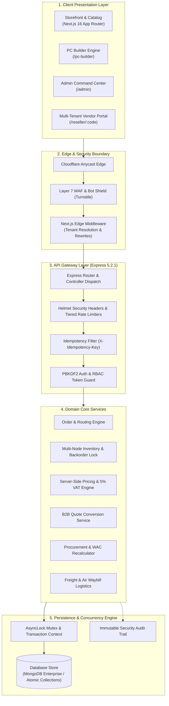

# NexTech Systems | Enterprise Computer & Technology Commerce Platform

<div align="center">

[](https://nextjs.org/)
[](https://react.dev/)
[](https://www.typescriptlang.org/)
[](https://expressjs.com/)
[](https://tailwindcss.com/)
[](https://www.cloudflare.com/)
[](.github/workflows/codeql.yml)
[](LICENSE)

<br/>

**NexTech Systems** is an enterprise-grade B2B & B2C computer hardware and technology commerce platform. Built for High-Performance Computing (HPC), AI workstations, datacenter infrastructure, and enterprise networking, the system provides stock-aware order routing, real-time PC builder compatibility diagnostics, multi-tenant vendor portals, regional multi-warehouse inventory balancing, and complete consumer white-label transparency.

[Key Capabilities](#platform-capabilities) • [Architecture](#system-architecture) • [Technology Stack](#technology-stack) • [Quick Start](#quick-start--local-development) • [Security & Concurrency](#security-hardening--concurrency-control)

</div>

---

## Platform Capabilities

### Commerce & Storefront Engine
- **White-Label Consumer Storefront**: Unified NexTech Certified branding across catalog, search, cart, and checkout, shielding retail buyers from third-party vendor complexity.
- **Real-Time PC Builder Compatibility**: Live hardware rule engine evaluating CPU sockets (`LGA1700`, `AM5`), RAM generations (`DDR5`/`DDR4`), and motherboard form factors with cumulative TDP power calculation and **+30% PSU headroom recommendations**.
- **Multi-SKU Variant Studio**: Dynamic Cartesian variant generation (e.g. Memory $\times$ Storage) with hierarchical SKUs, live SVG barcodes, and courier volumetric weight calculations (`(L × W × H) / 5000`).
- **Official Central Bank Dirham Standard**: Native integration with the official UAE Dirham currency symbol (`U+20C3`) along with dynamic multi-currency conversions (AED, USD, EUR, SAR, GBP, KWD).

### Operations & Supply Chain
- **Selective Order Routing & HITL Approvals**: Orders fulfilled solely from central stock confirm automatically (`CONFIRMED`/`PROCESSING`), while partner-fulfilled lines route to `PENDING_APPROVAL` with automated executive alerts (Discord, Telegram, Email, and Dashboard).
- **Multi-Node Regional Warehousing**: Live inventory balancing across four regional facilities (Dubai JAFZA Freezone, Deira Hub, Abu Dhabi Central, and Sharjah Depot) with granular state tracking (`available`, `committed`, `onHand`) and backorder controls.
- **B2B Quotations & 1-Click Order Conversion**: Corporate RFQ drafting suite supporting custom margin deltas, bulk quantity breaks, UAE 5% VAT calculations, and atomic 1-click conversion into verified Sales Orders.
- **Wholesale Procurement & WAC**: Supplier Purchase Order lifecycle with automated inventory increments and Weighted Average Cost (WAC) recalculation upon physical delivery.
- **Global Freight & Cargo Command Deck**: Air Waybill (AWB) generation, volumetric tare/gross calculations, transit milestone pipelines, carrier fleet dispatches, and IATA-style export manifests.
- **Multi-Tenant Reseller Portals**: Isolated vendor domains, Excel catalog bulk ingestion, attributed sales analytics, and automated credential provisioning.

---

## System Architecture



---

## Technology Stack

| Domain | Technology / Specification | Purpose |
| :--- | :--- | :--- |
| **Frontend Framework** | **Next.js 16.4** (App Router) + **React 19.3** | Server-Side Rendering (SSR), React Server Components, responsive layout |
| **Backend Framework** | **Node.js 20+ LTS** + **Express 5.2.1** | High-throughput REST API gateway with modular controllers |
| **Type Safety** | **TypeScript 5.8** | Shared interfaces and strict end-to-end compilation (`tsc --noEmit`) |
| **Styling & Icons** | **Tailwind CSS 3.4 / 4.3** + **Lucide React** | Enterprise design system, dark/light themes, and glassmorphism |
| **Edge Security** | **Cloudflare Turnstile** + **Helmet** | Anti-bot challenges, anti-DDoS posture, and secure HTTP response headers |
| **Cryptography** | Node **PBKDF2** + `crypto.randomBytes` | CWE-338 compliant PRNG, per-user 32-byte salts (100k rounds SHA-512) |
| **Concurrency Control** | **AsyncLock** + Re-entrant Mutex | Prevents double-spend, inventory oversell, and TOCTOU race conditions |
| **Idempotency** | In-Memory Sliding Cache (`5m TTL`) | Blocks duplicate order submissions via `Idempotency-Key` headers |
| **Data Ingestion** | **SheetJS (XLSX)** + **Multer** | Streaming multi-format Excel catalog ingestion for B2B vendors |
| **Persistence Engine** | **MongoDB Enterprise** + Atomic Store | Atomic multi-document mutations with safe temporary write commits |
| **Regional Payments** | **Tamara**, **Tabby**, **Stripe**, **COD** | UAE Central Bank Dirham standard, BNPL surcharges, and localized rules |

---

## Repository Layout

```
eCommerce_Store/
├── backend/                       # Express 5 REST API gateway
│   ├── src/
│   │   ├── config/                # Environment schema, database connections, and locks
│   │   ├── constants/             # Hardware taxonomy, brand definitions, and specifications
│   │   ├── controllers/           # HTTP route handlers (Auth, Orders, Products, Quotes, POs)
│   │   ├── middleware/            # JWT auth, tenant isolation, RBAC, and error handlers
│   │   ├── middlewares/           # Cloudflare security, rate limiting, and sanitization
│   │   ├── repositories/          # Data access layer for products, orders, users, and ebills
│   │   ├── routes/                # Express endpoint router definitions
│   │   ├── services/              # Domain services (Order, Pricing, Inventory, Idempotency)
│   │   └── utils/                 # Cryptographically secure random generators and helpers
│   └── package.json
├── frontend/                      # Next.js 16 App Router application
│   ├── app/                       # App Router pages, layouts, and serverless proxy routes
│   │   ├── admin/                 # Admin command deck (Analytics, Orders, Products, Quotes)
│   │   ├── api/                   # Resilient reverse-proxy handlers for backend endpoints
│   │   ├── cart/ & checkout/      # Multi-step checkout with server-side pricing validation
│   │   ├── pc-builder/            # Interactive PC hardware compatibility configurator
│   │   ├── products/              # Storefront catalog, filtering, and detail views
│   │   └── reseller/              # Multi-tenant partner portal routes
│   ├── components/                # Reusable UI component library (Admin, Account, Storefront)
│   ├── lib/                       # API client, context providers, and utility helpers
│   └── package.json
└── package.json                   # Root monorepo workspace configuration
```

---

## Quick Start & Local Development

### Prerequisites
- **Node.js**: `v18.18.0` or higher (Node 20+ LTS recommended)
- **npm**: `v9.0.0` or higher

### 1. Installation
Clone the repository and install dependencies across all workspaces:
```bash
git clone https://github.com/gl1tch0x1/NexTechSystem.git
cd NexTechSystem
npm install
```

### 2. Environment Configuration

#### Backend (`backend/.env`):
```env
PORT=5000
NODE_ENV=development
CLIENT_URL=http://localhost:3000
JWT_SECRET=your_cryptographic_jwt_secret_key_minimum_32_characters
PASSWORD_SALT=your_pbkdf2_password_salt_key

# Cloudflare Turnstile (Set to true in production)
CLOUDFLARE_SECURITY_ENABLED=false
CLOUDFLARE_TURNSTILE_SECRET_KEY=1x0000000000000000000000000000000AA
```

#### Frontend (`frontend/.env.local`):
```env
NEXT_PUBLIC_API_URL=http://localhost:5000/api
NEXT_PUBLIC_CLOUDFLARE_TURNSTILE_SITE_KEY=1x00000000000000000000AA
```

### 3. Running Development Servers
Execute both servers concurrently from the monorepo root:
```bash
# Start backend API (http://localhost:5000)
npm run dev:backend

# Start frontend application (http://localhost:3000)
npm run dev:frontend
```

---

## Core API Endpoints

| Resource | Method | Path | Description | Access |
| :--- | :---: | :--- | :--- | :--- |
| **Auth** | `POST` | `/api/auth/login` | Authenticate credentials and return signed JWT | Public |
| | `GET` | `/api/auth/me` | Fetch active user session profile and role permissions | Authenticated |
| **Catalog** | `GET` | `/api/products` | Paginated hardware search, filtering, and sorting | Public |
| | `POST` | `/api/admin/products` | Create hardware SKU with multi-node stock and variants | Admin |
| **Orders** | `POST` | `/api/orders` | Place idempotent customer order with selective routing | Customer / Admin |
| | `PUT` | `/api/admin/orders/:id/approve` | Approve reseller-sourced order and allocate stock | Admin |
| | `PUT` | `/api/admin/orders/:id/cargo` | Update logistics, AWB, weights, carrier, and dispatch | Admin |
| **Quotes** | `POST` | `/api/admin/quotes` | Create B2B corporate quotation with custom margins | Admin |
| | `POST` | `/api/admin/quotes/:id/convert` | 1-Click atomic conversion of quote into verified Sales Order | Admin |
| **Procurement** | `POST` | `/api/admin/purchase-orders` | Issue wholesale PO to manufacturer | Admin |
| | `PUT` | `/api/admin/purchase-orders/:id` | Receive PO, increment warehouse stock, and update WAC | Admin |
| **PC Builder** | `POST` | `/api/pc-builder/validate` | Verify socket, RAM generation, and wattage compatibility | Public |
| **Cart** | `POST` | `/api/cart/calculate` | Authoritative server-side pricing, coupons, and 5% VAT | Public |

---

## Security Hardening & Concurrency Control

NexTech Systems enforces zero-trust architecture across all layers, verified against GitHub CodeQL security rules:

1. **CWE-338 Cryptographically Secure PRNG**:
   All security-critical identifiers—including auto-generated reseller passwords, email verification OTPs, payment authorization codes, and order references—use Node `crypto.randomBytes` / `crypto.randomInt` and Web Crypto `crypto.getRandomValues`. Insecure `Math.random()` is prohibited.

2. **Concurrency Mutex & Race Condition Prevention**:
   The persistence engine integrates `AsyncLock` re-entrant transactions (`runTransaction`). High-frequency checkout operations acquire exclusive entity locks to eliminate Time-of-Check to Time-of-Use (TOCTOU) inventory race conditions and double-spending under concurrent traffic.

3. **Dual-Layer Idempotency**:
   Checkout requests require an `Idempotency-Key` or `X-Idempotency-Key` header. In-flight and recently executed operations are tracked in a 5-minute rolling TTL server-side cache, preventing duplicate order placements from multiple user clicks.

4. **Edge Defense & Anti-Bot Protection**:
   Integrated with Cloudflare Turnstile managed challenges, Helmet HTTP security headers, CORS origin whitelisting, and tiered route rate limiters (Auth: 60 req/15min, Public API: 300 req/15min, Orders: 100 req/15min).

5. **PBKDF2 Password Hashing**:
   Passwords receive a cryptographically random 32-byte salt and are derived using PBKDF2 with 100,000 iterations of SHA-512, verified via `crypto.timingSafeEqual` to prevent timing attacks.

---

## Testing & Quality Assurance

```bash
# Execute backend unit and integration tests
npm run test:backend

# Run comprehensive financial & security E2E matrix
npm --workspace=backend run test:e2e

# Execute multi-workspace static typecheck and linting
npm run lint

# Validate complete production builds
npm run build
```

---

## License

This project is licensed under the MIT License. See the [LICENSE](LICENSE) file for complete details.
