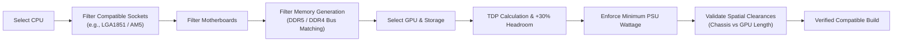
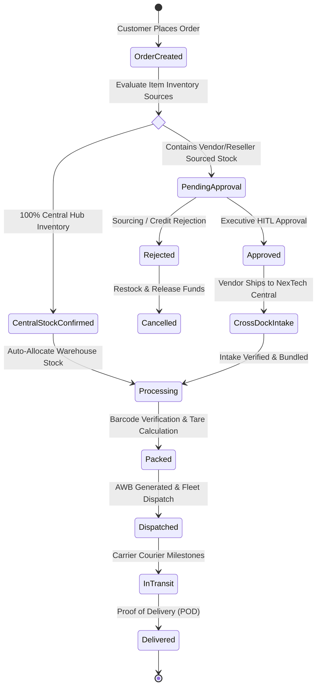

# NexTech Systems | Enterprise Technology Commerce & Hardware Distribution Platform

<div align="center">

[](https://nextjs.org/)
[](https://react.dev/)
[](https://www.typescriptlang.org/)
[](https://nodejs.org/)
[](https://expressjs.com/)
[](https://tailwindcss.com/)
[](https://www.cloudflare.com/)
[](.github/workflows/codeql.yml)
[](LICENSE)

<br/>

**NexTech Systems** is an enterprise-grade B2B and B2C computer hardware distribution and technology commerce platform. Architected specifically for High-Performance Computing (HPC), AI workstations, datacenter server hardware, and enterprise networking equipment, the platform delivers stock-aware multi-warehouse order routing, real-time PC builder compatibility diagnostics, multi-tenant vendor portals, corporate RFQ/quotation lifecycle management, global air cargo freight dispatch, and complete white-label consumer storefront transparency.

[Key Capabilities](#platform-capabilities) • [System Architecture](#system-architecture) • [Core Subsystems](#core-subsystems--modules) • [Tech Specs Matrix](#enterprise-technical-specifications-matrix) • [Security & Concurrency](#security-hardening--concurrency-control) • [API Directory](#core-api-directory) • [Quick Start](#quick-start--local-development)

</div>

---

## Executive Summary & Design Tenets

Modern enterprise computer hardware commerce requires handling extreme configuration complexity—socket pinouts, PCIe lane allocation, memory timing topologies, multi-node warehouse allocations, and fluctuating wholesale costs. NexTech Systems addresses these demands with four core principles:

1. **Zero-Trust Reliability & Concurrency Control**: Re-entrant mutex locking (`AsyncLock`) and rolling idempotency caches prevent inventory overselling, double allocations, and TOCTOU race conditions under high-concurrency enterprise flash procurement.
2. **Deterministic Hardware Verification**: Automated validation rules verify component inter-compatibility (motherboard sockets, memory generations, form-factor clearances, and thermal/power envelopes) before transactions reach payment processing.
3. **Decoupled White-Label Operations**: Multi-tenant vendor and reseller inventory feeds are aggregated and normalized into a single consumer-facing catalog under NexTech Certified OEM warranties.
4. **End-to-End Enterprise Logistics**: From B2B Request for Quotation (RFQ) drafting and supplier purchase orders (with Weighted Average Costing) to volumetric freight calculation and Air Waybill (AWB) generation.

---

## System Architecture

NexTech Systems is constructed as a decoupled, multi-tier enterprise architecture separating edge security, client presentation, API orchestration, domain business engines, and persistence locking:

```mermaid
graph TB
    subgraph ClientLayer["1. Client Presentation & Portals"]
        B2C["Storefront & Catalog<br/>(Next.js 16 App Router)"]
        SPECS["Technical Specs Matrix<br/>(Categorized Progressive Telemetry)"]
        BUILDER["PC Builder Compatibility Engine<br/>(/pc-builder)"]
        ADMIN["Executive Admin Command Deck<br/>(/admin)"]
        RESELLER["Multi-Tenant Vendor Portal<br/>(/reseller/:code)"]
    end

    subgraph EdgeLayer["2. Cloudflare Edge & Boundary"]
        CF_DNS["Cloudflare Anycast DNS & CDN"]
        CF_WAF["Layer 7 WAF & DDoS Mitigation"]
        CF_TURN["Turnstile Bot Challenge Engine"]
        EDGE_MW["Next.js Edge Middleware<br/>(Subdomain & Tenant Rewrites)"]
    end

    subgraph ApiGateway["3. API Gateway Layer (Express 5.2.1)"]
        ROUTER["REST Dispatch Router"]
        SEC_HEADERS["Helmet Security Profile"]
        RATE_LIMIT["Tiered Redis/Memory Rate Limiters"]
        IDEMP_GUARD["Idempotency Filter (X-Idempotency-Key)"]
        AUTH_GUARD["PBKDF2 Token Authentication & RBAC"]
    end

    subgraph DomainServices["4. Core Domain Service Engines"]
        ORDER_ENG["Order Routing & Split Engine"]
        STOCK_ENG["Multi-Node Regional Inventory Engine"]
        PRICE_ENG["Server-Side Pricing & 5% VAT Engine"]
        QUOTE_ENG["B2B RFQ & Quote Conversion Service"]
        PO_ENG["Supplier PO & WAC Recalculator"]
        CARGO_ENG["Freight Logistics & AWB Manifest Engine"]
        COMPAT_ENG["Hardware Topology Compatibility Validator"]
    end

    subgraph PersistenceLayer["5. Concurrency & Persistence Engine"]
        MUTEX_LOCK["AsyncLock Re-entrant Entity Mutex"]
        DATA_STORE[("MongoDB Enterprise / Atomic Data Store")]
        AUDIT_LOGS[("Immutable Cryptographic Audit Trail")]
    end

    ClientLayer --> CF_DNS --> CF_WAF --> CF_TURN --> EDGE_MW
    EDGE_MW --> ROUTER
    ROUTER --> SEC_HEADERS --> RATE_LIMIT --> IDEMP_GUARD --> AUTH_GUARD
    AUTH_GUARD --> DomainServices
    DomainServices --> MUTEX_LOCK --> DATA_STORE
    DomainServices -.-> AUDIT_LOGS
```



---

## Platform Capabilities

### 1. Storefront & Catalog Experience
- **White-Label Consumer Storefront**: Unifies products from central stock and authorized distributors under a single NexTech Certified standard, shielding retail customers from third-party vendor complexity.
- **Enterprise Technical Specifications Matrix**: Clean, structured hardware datasheet grouping parameters into standardized domains (`Processor & Platform`, `Memory & Storage`, `Display & Visuals`, `Graphics & GPU`, `Design, Input & Mobility`, `System, OS & Warranty`) with progressive disclosure ("View All Specifications"), live search, and one-click Markdown datasheet export.
- **Multi-SKU Variant Studio**: Dynamic Cartesian variant generation (e.g., Processor $\times$ Memory $\times$ Storage) with hierarchical SKUs, volumetric courier weights, and live SVG barcodes.
- **UAE Central Bank Dirham Standard**: Native integration with the official UAE Dirham currency symbol (`U+20C3`), complete with multi-currency conversions across AED, USD, EUR, SAR, GBP, and KWD.

### 2. PC Builder Hardware Compatibility Engine
- **Pinout & Socket Topology**: Verifies socket matching across Intel (`LGA1851`, `LGA1700`, `LGA1200`) and AMD (`AM5`, `AM4`, `TR5`, `SP5`).
- **Memory Bus Generation**: Validates RAM standard compatibility (`DDR5`, `DDR4`, `LPDDR5X`) and channel configurations against motherboard slot limits.
- **Form-Factor Spatial Clearances**: Checks physical dimensions across chassis, motherboard form factors (E-ATX, ATX, Micro-ATX, Mini-ITX), and GPU lengths.
- **Cumulative TDP & PSU Headroom Rule**: Calculates aggregate hardware thermal power draws and enforces a mandatory **+30% PSU headroom safety factor** to safeguard transient power spikes.



### 3. Supply Chain, Inventory & Fulfillment
- **Selective Order Routing & HITL Approvals**: Orders fulfilled strictly from central inventory confirm automatically (`CONFIRMED`/`PROCESSING`), while orders requiring vendor cross-docking route to Human-In-The-Loop (`PENDING_APPROVAL`) with real-time Discord, Telegram, and Email webhooks.
- **Multi-Node Regional Warehousing**: Live inventory balancing across four regional facilities:
  - **Dubai JAFZA Hub**: Tax-free zone bulk import & global redistribution.
  - **Deira Distribution Center**: High-velocity retail & B2C express dispatch.
  - **Abu Dhabi Central Facility**: Government & corporate enterprise accounts.
  - **Sharjah Logistics Depot**: Heavy freight, server rack enclosures & bulk storage.
- **Granular Inventory Telemetry**: Real-time state tracking across `available`, `committed`, `inTransit`, and `onHand` stock with backorder management.
- **Weighted Average Cost (WAC) Engine**: Automatically recalculates inventory unit valuation upon physical receipt of supplier purchase orders.

### 4. B2B Corporate Trade, Procurement & Air Cargo
- **B2B Quotations & Atomic Sales Order Conversion**: Comprehensive corporate RFQ drafting with configurable profit margins, volume discount breaks, UAE 5% VAT calculations, and atomic 1-click conversion into verified Sales Orders.
- **Wholesale Procurement Lifecycle**: Purchase Order issuance, tracking, warehouse intake, and automatic stock level increments.
- **Global Freight Logistics & Cargo Deck**: Air Waybill (AWB) generation, IATA tare/gross weight algorithms, courier fleet dispatch, transit milestone updates, and customs export manifests.
- **Multi-Tenant Reseller Portals**: Isolated partner subdomains (`/reseller/:code`), bulk Excel catalog ingestion via streaming SheetJS, attributed commission tracking, and automated credential issuance.

---

## Enterprise Technical Specifications Matrix

The product detail page features an executive **Technical Specifications Matrix** designed to adhere to Apple, Lenovo PSREF, and Dell Precision hardware engineering standards:

```
┌────────────────────────────────────────────────────────────────────────────────────────┐
│  Technical Specifications                                                              │
│  Manufacturer specifications, hardware architecture, and system details                │
│                                                              [Filter specs...]  [Copy] │
├──────────────────────────┬─────────────────────────────────────────────────────────────┤
│  PROCESSOR & PLATFORM    │  Processor Brand        │  Intel                            │
│  Compute cores,          │  Processor Model        │  Core Ultra 7 155H                │
│  architecture & socket   │  Processor Cores        │  16 Cores                         │
│  interface               │  Socket Form Factor     │  LGA1851                          │
├──────────────────────────┼─────────────────────────┼───────────────────────────────────┤
│  MEMORY & STORAGE        │  RAM Capacity           │  16GB                             │
│  System memory bus,      │  RAM Type               │  DDR5 SODIMM                      │
│  channels & NVMe SSD     │  Storage Capacity       │  1TB                              │
│                          │  Storage Type           │  NVMe PCIe 4.0 SSD                │
├──────────────────────────┼─────────────────────────┼───────────────────────────────────┤
│  DISPLAY & VISUALS       │  Screen Size            │  14.0 INCH                        │
│  Panel diagonal, native  │  Display Resolution     │  1920 x 1200 (WUXGA)              │
│  resolution & touch      │  Display Technology     │  IPS Anti-Glare                   │
│                          │  Touchscreen Support    │  ✓ Yes (Multi-Touch)              │
└──────────────────────────┴─────────────────────────┴───────────────────────────────────┘
   [                       ▼ View All Specifications                         ]
```

### Key Architectural Characteristics
- **Structured Categorical Domains**: Parameters are partitioned deterministically into 6 engineering categories (`Processor & Platform`, `Memory & Storage`, `Display & Visuals`, `Graphics & GPU`, `Design, Input & Mobility`, and `System, OS & Warranty`).
- **Priority Ranking System**: High-impact hardware specifications (Processor Model, Cores, RAM, SSD) render first; secondary details (Chassis Color, Bag, MPN) follow logically.
- **Progressive Disclosure ("View All Specifications")**: By default, the table renders a curated, compact view of primary compute and memory parameters. Clicking "View All Specifications" smoothly expands the full matrix and hardware acceleration capabilities.
- **Live Search Filtering**: An integrated filter input searches parameter keys and values in real time, automatically expanding matching rows.
- **Monospace Code Formatting & Contextual Badges**: Part numbers (`MPN`), display resolutions, and sockets render in monospace; conditions (`Brand New (Factory Sealed)`) and warranties render with clean status tags.
- **1-Click Markdown Datasheet Export**: Formats the entire specification dataset into structured Markdown tables and copies it to the clipboard for corporate procurement workflows.

---

## Order Routing & Fulfillment State Machine



---

## Technology Stack

| Domain | Technology / Library | Version / Spec | Functional Purpose |
| :--- | :--- | :--- | :--- |
| **Frontend Framework** | **Next.js** (App Router) | `16.4.0` | React Server Components (RSC), SSR, dynamic routing, edge middleware |
| **UI Library** | **React** | `19.3.0` | Declarative UI, optimistic rendering, hooks & concurrent transitions |
| **Language** | **TypeScript** | `5.8.2` | Monorepo-wide shared types, strict static compilation (`tsc --noEmit`) |
| **Styling Engine** | **Tailwind CSS** | `3.4 / 4.3` | Utility-first responsive design, dark/light theme, custom glassmorphism |
| **Iconography** | **Lucide React** | `0.470+` | Clean, accessible vector icons for enterprise interfaces |
| **Backend Runtime** | **Node.js LTS** | `20+ LTS` | High-throughput asynchronous JavaScript runtime |
| **API Gateway** | **Express** | `5.2.1` | REST endpoints, controller dispatch, stream handlers |
| **Security & Headers**| **Helmet** | `8.0.0` | HTTP security response headers (CSP, HSTS, X-Content-Type) |
| **Bot Mitigation** | **Cloudflare Turnstile** | Edge WAF | Zero-friction invisible CAPTCHA and anti-bot verification |
| **Cryptography** | **Node `crypto`** | FIPS/Standard | PBKDF2 (100k rounds SHA-512), `crypto.randomBytes`, `timingSafeEqual` |
| **Concurrency Control**| **AsyncLock** | Re-entrant | Entity-level mutex locking preventing checkout and inventory race conditions |
| **Data Ingestion** | **SheetJS (xlsx)** + **Multer** | `0.18.5` / `2.4.0` | Streaming bulk Excel product ingestion and secure upload quarantine |
| **Persistence Engine** | **MongoDB Enterprise** | `7.6.0` | Document data store with atomic transactions and indexes |
| **Regional Payments** | **Tamara**, **Tabby**, **Stripe**, **COD** | v3 APIs | Central Bank Dirham compliance, BNPL split payments, localized checkout |

---

## Security Hardening & Concurrency Control

NexTech Systems enforces zero-trust architecture across all layers, verified against GitHub CodeQL security rules:

### 1. Cryptographically Secure PRNG (CWE-338)
All security-critical tokens—including reseller onboarding credentials, email verification OTPs, payment authorization keys, and order references—rely on Node `crypto.randomBytes()`, `crypto.randomInt()`, or Web Crypto `crypto.getRandomValues()`. Insecure `Math.random()` is strictly prohibited across both client and server codebases.

### 2. Concurrency Mutex & Race Condition Prevention
The persistence and inventory subsystem implements `AsyncLock` re-entrant mutexes. Critical checkout paths lock SKU and Warehouse entities during quantity validation, preventing Time-of-Check to Time-of-Use (TOCTOU) inventory oversells and balance double-spending under concurrent procurement traffic.

### 3. Dual-Layer Idempotency Guarantees
Checkout and order-creation endpoints mandate an `Idempotency-Key` or `X-Idempotency-Key` header. Requests are recorded in a server-side rolling TTL cache (5-minute window), safely absorbing network retries and duplicate user clicks without duplicate financial transactions.

### 4. Edge WAF & Anti-Bot Defense
Edge requests pass through Cloudflare Turnstile token validation, Helmet HTTP security headers, CORS origin whitelisting, and tiered rate limiters:
- **Authentication Routes**: 60 requests per 15 minutes.
- **Order Placement**: 100 requests per 15 minutes.
- **Public Product Catalog**: 300 requests per 15 minutes.

### 5. PBKDF2 Password Hashing & Timing-Safe Comparison
User and reseller passwords are protected with a unique, cryptographically random 32-byte salt and derived using PBKDF2 with 100,000 iterations of SHA-512. Password verifications execute through `crypto.timingSafeEqual` to eliminate side-channel timing analysis attacks.

### 6. Path Traversal & Upload Quarantine (CWE-022 & CWE-912)
File uploads enforce server-generated UUID filenames (`crypto.randomUUID()`), strict MIME and file extension allowlists, canonical directory sandboxing, and containment validation before storage.

### 7. ReDoS Polynomial Backtracking Defense (CWE-1333)
All high-traffic input parsers, email validators, and administrative sanitizers utilize linear $O(n)$ deterministic verification routines, eliminating catastrophic polynomial backtracking vulnerabilities.

### 8. Sensitive Logging Redaction & DOM XSS Sanitization (CWE-312, CWE-532, CWE-079)
Strict redaction filters ensure authorization OTPs, passwords, and tokens are never written to `stdout`/`stderr`. Dynamic user-supplied DOM assets enforce protocol verification (`http:`, `https:`, relative `/`) and meta-character escaping to prevent cross-site scripting vectors.

---

## Core API Directory

### Authentication & Sessions
| Method | Endpoint | Description | Auth Level |
| :---: | :--- | :--- | :--- |
| `POST` | `/api/auth/login` | Authenticate customer/admin credentials and issue signed JWT | Public |
| `POST` | `/api/auth/register` | Register new user account with cryptographic password hashing | Public |
| `POST` | `/api/auth/otp/send` | Dispatch time-limited verification OTP via secure email pipeline | Public |
| `POST` | `/api/auth/otp/verify` | Verify OTP code and issue authorization token | Public |
| `GET` | `/api/auth/me` | Fetch active user session profile, permissions, and company info | Authenticated |

### Catalog & Hardware Specifications
| Method | Endpoint | Description | Auth Level |
| :---: | :--- | :--- | :--- |
| `GET` | `/api/products` | Paginated catalog search with faceted category, brand & spec filters | Public |
| `GET` | `/api/products/:slug` | Retrieve complete product datasheet, variants, and specifications | Public |
| `POST` | `/api/admin/products` | Create hardware SKU with multi-node stock, variants, and specs | Admin |
| `PUT` | `/api/admin/products/:id` | Update product parameters, pricing, and category assignments | Admin |
| `DELETE` | `/api/admin/products/:id` | Soft-delete or archive hardware SKU | Admin |

### Orders & Logistics
| Method | Endpoint | Description | Auth Level |
| :---: | :--- | :--- | :--- |
| `POST` | `/api/orders` | Idempotent order placement with automated inventory routing | Customer / Admin |
| `GET` | `/api/orders/:id` | Retrieve detailed order status, fulfillment splits, and tracking | Customer / Admin |
| `PUT` | `/api/admin/orders/:id/approve` | Approve vendor-sourced line items and allocate stock | Admin |
| `PUT` | `/api/admin/orders/:id/cargo` | Issue Air Waybill (AWB), record weights, and assign carrier | Admin |
| `GET` | `/api/admin/orders/export` | Export orders to Excel with financial and tax breakdown | Admin |

### B2B Quotes & Procurement
| Method | Endpoint | Description | Auth Level |
| :---: | :--- | :--- | :--- |
| `POST` | `/api/admin/quotes` | Draft B2B corporate quotation with custom margins and quantity breaks | Admin |
| `POST` | `/api/admin/quotes/:id/convert` | Atomic 1-click conversion of quote into verified Sales Order | Admin |
| `POST` | `/api/admin/purchase-orders` | Issue wholesale Purchase Order to hardware manufacturer | Admin |
| `PUT` | `/api/admin/purchase-orders/:id` | Receive PO shipment, increment warehouse stock, and recalculate WAC | Admin |

### PC Builder Compatibility
| Method | Endpoint | Description | Auth Level |
| :---: | :--- | :--- | :--- |
| `POST` | `/api/pc-builder/validate` | Evaluate socket, RAM generation, and wattage compatibility | Public |
| `GET` | `/api/pc-builder/components` | Retrieve categorized components compatible with active configuration | Public |

---

## Repository Layout

```
eCommerce_Store/
├── backend/                       # Express 5 REST API gateway
│   ├── src/
│   │   ├── config/                # Environment schema, database connections, and locks
│   │   ├── constants/             # Hardware taxonomy, brand definitions, and specifications
│   │   ├── controllers/           # HTTP route handlers (Auth, Orders, Products, Quotes, POs)
│   │   ├── middleware/            # JWT auth, tenant isolation, RBAC, and error handlers
│   │   ├── middlewares/           # Cloudflare security, rate limiting, and sanitization
│   │   ├── models/                # Document schemas & TypeScript database models
│   │   ├── repositories/          # Data access layer for products, orders, users, and ebills
│   │   ├── routes/                # Express endpoint router definitions
│   │   ├── services/              # Domain services (Order, Pricing, Inventory, Idempotency)
│   │   └── utils/                 # Cryptographically secure random generators and helpers
│   ├── tests/                     # Unit, smoke, and API security tests
│   └── package.json
├── frontend/                      # Next.js 16 App Router application
│   ├── app/                       # App Router pages, layouts, and serverless proxy routes
│   │   ├── admin/                 # Admin command deck (Analytics, Orders, Products, Quotes)
│   │   ├── api/                   # Resilient reverse-proxy handlers for backend endpoints
│   │   ├── cart/ & checkout/      # Multi-step checkout with server-side pricing validation
│   │   ├── pc-builder/            # Interactive PC hardware compatibility configurator
│   │   ├── products/              # Storefront catalog, filtering, and detail views
│   │   └── reseller/              # Multi-tenant partner portal routes
│   ├── components/                # Reusable UI component library (Admin, Account, Storefront)
│   │   ├── admin/                 # Product editor, order manager, cargo dispatch decks
│   │   ├── product/               # TechnicalSpecificationsMatrix, ProductCard, Gallery
│   │   └── ui/                    # Design system primitives, logos, and badges
│   ├── lib/                       # API client, context providers, and utility helpers
│   ├── types/                     # Shared TypeScript interfaces (Product, Order, Variant)
│   └── package.json
├── .github/                       # CI/CD pipelines & GitHub Actions
│   └── workflows/                 # CodeQL analysis and automated build workflows
└── package.json                   # Root monorepo workspace configuration
```

---

## Quick Start & Local Development

### Prerequisites
- **Node.js**: `v20.0.0` or higher (Node 20+ LTS recommended)
- **npm**: `v9.0.0` or higher
- **MongoDB**: Local MongoDB instance (`v6.0+`) or MongoDB Atlas URI

### 1. Installation
Clone the repository and install dependencies across all workspaces:
```bash
git clone https://github.com/gl1tch0x1/NexTechSystem.git
cd NexTechSystem
npm install
```

### 2. Environment Configuration

#### Backend Configuration (`backend/.env`):
```env
PORT=5000
NODE_ENV=development
CLIENT_URL=http://localhost:3000

# Cryptographic Keys (Minimum 32 characters)
JWT_SECRET=your_cryptographic_jwt_secret_key_minimum_32_characters
PASSWORD_SALT=your_pbkdf2_password_salt_key

# Database Connection
MONGODB_URI=mongodb://localhost:27017/nextech_enterprise

# Cloudflare Turnstile (Set to true in production)
CLOUDFLARE_SECURITY_ENABLED=false
CLOUDFLARE_TURNSTILE_SECRET_KEY=1x0000000000000000000000000000000AA

# Alert Webhooks (Optional)
DISCORD_WEBHOOK_URL=
TELEGRAM_BOT_TOKEN=
TELEGRAM_CHAT_ID=
```

#### Frontend Configuration (`frontend/.env.local`):
```env
NEXT_PUBLIC_API_URL=http://localhost:5000/api
NEXT_PUBLIC_CLOUDFLARE_TURNSTILE_SITE_KEY=1x00000000000000000000AA
NEXT_PUBLIC_SITE_URL=http://localhost:3000
```

### 3. Database Seeding (Optional)
Seed the database with verified enterprise hardware SKUs, categories, and inventory nodes:
```bash
npm --workspace=backend run seed
```

### 4. Running Development Servers
Execute both backend and frontend concurrently from the monorepo root:
```bash
# Start backend API (http://localhost:5000)
npm run dev:backend

# Start frontend application (http://localhost:3000)
npm run dev:frontend
```

---

## Testing & Quality Assurance

```bash
# Execute backend unit and integration tests
npm run test:backend

# Run comprehensive financial, inventory & security E2E matrix
npm --workspace=backend run test:e2e

# Execute multi-workspace static typecheck and linting
npm run lint

# Validate complete production builds across frontend and backend
npm run build
```

---

## License

This project is licensed under the MIT License. See the [LICENSE](LICENSE) file for complete details.
